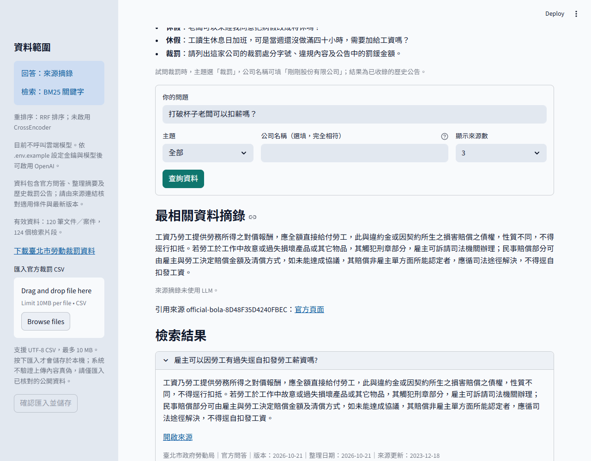
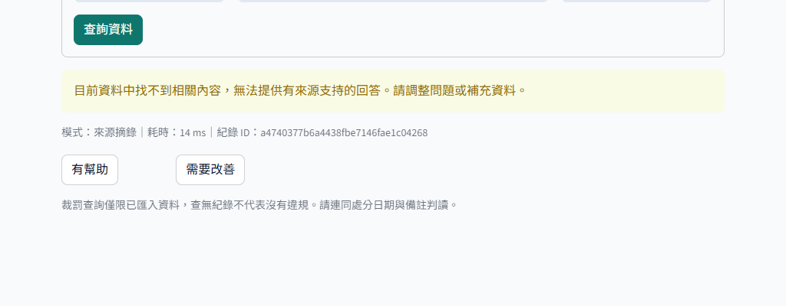
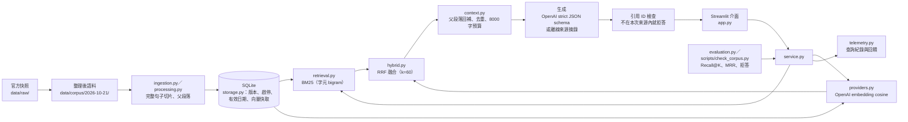

# 打工權益問答與勞動裁罰紀錄檢索 RAG

[](https://github.com/mina201199/hr-leave-attendance-rag/actions/workflows/ci.yml)

以官方勞動問答與臺北市裁罰公告為知識庫的 RAG 問答系統：回答薪資、工時、休假問題時一定附上可點開的官方來源，證據不足就拒答；也能依完整公司名稱查詢已收錄的歷史裁罰紀錄。

> **關於 repo 名稱**：這個 repo 原本規劃做企業內部的「請假與出勤制度助理」，所以名稱是 `hr-leave-attendance-rag`。`main` 分支實際完成的是公開資料版的**打工權益問答**；企業版（登入、三角色權限、虛構公司制度）位於**尚未合併**的 [`codex/enterprise-mvp`](https://github.com/mina201199/hr-leave-attendance-rag/tree/codex/enterprise-mvp) 分支，完成狀態以該分支 README 為準，本頁只描述 `main`。

## 要解決的問題

打工族與新鮮人遇到「打破東西可以扣薪嗎」「兼職有沒有特休」這類問題時，常在論壇看到互相矛盾的說法；官方答案雖然存在，卻分散在勞動局、勞動部的問答頁與裁罰公告裡，不容易找到、也不容易判斷適用條件。

一般聊天機器人可以給出流暢的回答，但無法保證內容來自官方、也可能編造法條。這個專案的重點是**可核對**：每個回答重點都要對應到本次檢索送入的來源段落，否則就拒答。難點在於中文短問題的檢索（口語與法規用語落差大）、避免模型引用不存在的來源，以及在沒有大量標註資料下如何誠實地評估。

## Demo

離線模式（BM25＋來源摘錄，不呼叫任何付費 API）的實際執行畫面，資料為 repo 內的公開官方語料：





本專案沒有線上部署；可用下方「如何執行」的離線指令或 Docker 在本機重現同樣畫面。

## 架構



`RAG_RETRIEVAL=bm25` 時只走 BM25；`hybrid` 時才會呼叫 embedding 並以 RRF 融合。Python 模組除 `scripts/` 外都在 `src/labor_rag/`。各層說明見 [docs/architecture.md](docs/architecture.md)。

## 技術重點

- **中文關鍵字檢索不靠斷詞套件**（`retrieval.py`）：自行實作 BM25，中文以字元二元詞（bigram）切詞，另有少量同義詞正規化，不需要額外的斷詞字典。
- **Hybrid 檢索用名次融合**（`hybrid.py`）：BM25 與 `text-embedding-3-small` 向量 cosine 各取候選，以 Reciprocal Rank Fusion（k=60）融合名次，避免兩種分數尺度不同的問題。可選的本機 CrossEncoder reranker 預設關閉。
- **結構化輸出＋引用驗證**（`providers.py`、`service.py`）：OpenAI Responses API 以 strict JSON schema 回傳「重點＋citationIds」；`service.py` 檢查每個引用 ID 都必須是本次送入的來源，否則整個回答改為拒答，而不是只把錯誤引用刪掉。
- **離線模式**：`RAG_PROVIDER=extractive` 時不呼叫 API，直接回傳來源摘錄。CI、測試、Docker 預設都走這條路徑，不需要任何 secret。
- **版本化知識庫**（`storage.py`）：SQLite 保存歷史版本、啟停狀態、有效日期與向量內容雜湊快取；重新匯入語料會先備份並停用舊摘要，不覆寫歷史。
- **付費測試有預算閘門**（`scripts/check_corpus.py`）：`--live` 每次請求先保守預留 US$0.05，連同 `reports/` 內先前報告的預留合計不超過 US$3（只約束此腳本，不是帳戶上限）。
- **資料處理**：原始快照保留來源與 SHA-256（`manifest.json`）；官方網頁內嵌的 Google Maps API key 與裁罰 CSV 的負責人姓名已遮蔽後才提交。

## 成果與數字

| 項目 | 結果 | 來源 |
| --- | --- | --- |
| 語料規模 | 40 筆官方問答＋80 件臺北市裁罰，共 120 筆、124 個檢索片段 | [docs/corpus-120.md](docs/corpus-120.md)、`data/corpus/2026-10-21/` |
| 自動化測試 | **70 passed**（2026-10-30，本機 Python 3.13.9，離線設定同 CI） | `python -m pytest -q` |
| 18 題語料檢查（離線 BM25＋摘錄） | 狀態 18/18 符合；16 題有答案題前 3 名命中預期來源 16/16，摘錄引用到預期來源 14/16；2 題無關問題拒答 | 2026-10-30 執行 `scripts/check_corpus.py`（報告寫入 `reports/`，未提交） |
| 18 題語料檢查（OpenAI 生成＋hybrid） | 狀態 18/18 符合；前 3 名命中 16/16、引用預期來源 16/16；人工核對 17 題有來源支持、1 題需覆核 | [reports/corpus-120-validation-20261021.json](reports/corpus-120-validation-20261021.json)（2026-10-21） |

這些是 18 題**開發檢查**，不是獨立測試集成績。live 結果之後提示改為 `labor-grounded-v3`，只複測了特休 2 題（[報告](reports/annual-condition-validation-20261021.json)），沒有重跑完整題組。

## 如何執行

需要 Python 3.11 以上。以下為 PowerShell；離線模式不需要 API key，也不會產生雲端費用。

```powershell
python -m venv .venv
.\.venv\Scripts\python.exe -m pip install -e ".[dev]"
.\.venv\Scripts\python.exe -m pytest -q

# 離線模式：只影響目前的 PowerShell，不改寫 .env
$env:RAG_PROVIDER = "extractive"
$env:RAG_RETRIEVAL = "bm25"
$env:OPENAI_API_KEY = ""
.\.venv\Scripts\python.exe -X utf8 scripts/prepare_corpus.py --import   # 匯入 120 筆語料（先備份本機知識庫）
.\.venv\Scripts\python.exe -X utf8 scripts/check_corpus.py              # 18 題離線檢查
.\.venv\Scripts\python.exe -m streamlit run app.py
```

開啟 <http://127.0.0.1:8501>，側欄應顯示 120 筆文件／案件、124 個檢索片段。輸入「打破杯子老闆可以扣薪嗎？」應有來源摘錄與官方連結；輸入「火星火山地質」應顯示資料不足。Windows 若出現 `ZoneInfoNotFoundError: Asia/Taipei`，在同一個虛擬環境執行 `pip install tzdata`。

**Docker**（映像建置時匯入語料，預設離線模式）：

```powershell
docker build -t labor-rights-rag .
docker run --rm -p 8501:8501 labor-rights-rag
```

**OpenAI 模式**：複製 `.env.example` 為 `.env`，只在本機填入自己的 `OPENAI_API_KEY`（`.env` 已列入 `.gitignore` 與 `.dockerignore`）。要用 hybrid 檢索需在側欄手動建立向量索引，會呼叫 API 並計費。Docker 可用 `-e OPENAI_API_KEY -e RAG_PROVIDER=openai` 從目前終端機傳入金鑰，不寫進映像檔。

CI（`.github/workflows/ci.yml`）在 push 到 `main` 與每個 PR 時以 Python 3.12 執行 `pytest`，設定 `RAG_PROVIDER=extractive`、`RAG_RETRIEVAL=bm25` 與空白金鑰；測試只走離線路徑或 mock 的 HTTP 回應。

## 已知限制與下一步

- **尚未做 hybrid 與純 BM25 的消融評估。** live 報告固定使用 hybrid＋OpenAI 生成，離線檢查則是 BM25＋摘錄，兩者生成設定不同，無法說明加入向量檢索帶來多少改善。
- **Reranker 預設關閉且未評估**；repo 內沒有任何啟用 CrossEncoder 的結果。
- 題組只有 18 題（另有特休條件回歸 6 題與 2 題），屬開發檢查；裁罰資料只選 80 件，不能代表公司完整違規紀錄，查無紀錄不代表沒有違規。
- 沒有跨平台依賴鎖定檔，安裝解析出的版本可能不同。
- 網頁查詢與建索引沒有共用的全站費用上限；腳本的預算閘門只約束 `check_corpus.py --live`。
- `main` 沒有登入與資料隔離，不適合存放受限的企業內規。
- 原始快照已遮蔽 API key 與負責人姓名，但 Git 歷史中的舊版本仍含原始內容。

下一步：在相同題組、相同生成設定下比較 BM25／hybrid／hybrid＋reranker；建立不參與調參的保留題組；把企業版分支的授權測試完成驗收後再合併。

> [RAG四模組詳細架構圖.png](RAG四模組詳細架構圖.png) 是專題初期的四模組規劃，部分項目（例如 PDF／DOCX 解析、登入）`main` 沒有實作；實際模組以上方架構圖與 [docs/architecture.md](docs/architecture.md) 為準。原版操作細節見 [docs/legacy-public-rag.md](docs/legacy-public-rag.md)。

## 我負責的部分

本專案由我獨立完成，涵蓋需求定義、資料蒐集與整理、系統設計、檢索與生成實作、評估腳本、測試、CI／Docker 與文件。

## 授權

程式碼以 [MIT License](LICENSE) 授權。`data/raw/`、`data/corpus/`、`data/seed/` 中的官方問答與裁罰公告內容，權利屬原發布機關，不在 MIT 授權範圍內；使用時請依原來源的規範。
