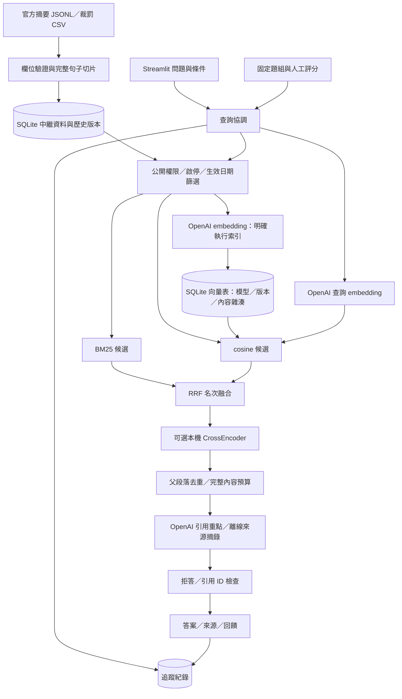

# 打工權益 RAG：六層實作架構

依使用者指定 `C:/Users/User/Downloads/企業級RAG_教學簡報.html` 第 14 頁六層架構，以及第 17–20、26–29、32、37–40 頁的切片、版本、混合檢索、權限、上下文與治理概念實作。主題限於薪資、工時、休假及勞動裁罰；簡報的企業合約案例與課堂操作指令不作為系統需求。

## 執行資料流

2026-10-21 使用者確認：回答模型 `gpt-6-luna`、Embedding `text-embedding-3-small`、混合檢索，第一版不啟用 Reranker。`.env` 已選擇雲端模式；缺少金鑰時明確提示，不自動退回離線模式。其他技術選型變更前先與使用者討論。

離線模式跳過兩個 OpenAI embedding 節點與雲端生成。未啟用 CrossEncoder 時，RRF 結果直接送上下文組裝。

## 六層與程式碼

| 層 | 主要檔案 | 已實作行為 |
|---|---|---|
| 1 資料來源 | `ingestion.py`、`data/seed/` | JSONL、官方欄名 CSV；來源網址、整理日、來源更新日；摘要與裁罰類型分開 |
| 2 處理 | `processing.py`、`models.py` | 以標點與換行切句，目標 500 字，完整句子重疊預算 60 字；不切斷長句；保留父片段 |
| 3 儲存 | `storage.py` | documents、revisions、vectors 表；原子版本匯入；舊版保留；模型與內容相符才讀取向量 |
| 4 檢索 | `retrieval.py`、`hybrid.py`、`context.py` | 有效版本與存取篩選、BM25 與向量各取最多 10 個候選、RRF k=60、可選 CrossEncoder、TopK 1–10、父段落去重與 8000 字預算 |
| 5 生成 | `providers.py`、`generation.py`、`service.py` | Responses 結構化 claims、每項引用、證據不足拒答、逾時／HTTP／格式錯誤處理、引用存在性驗證 |
| 6 應用與治理 | `app.py`、`runtime.py`、`telemetry.py`、`evaluation.py`、`scripts/` | 本機操作、持久資料、API 模式顯示、紀錄與回饋、評估與維護 |

原有四模組分工可以保留：A 負責第 1–2 層；B 負責第 3–4 層；C 負責第 5 層；D 負責第 6 層。六層是系統責任，四模組是專題分工。

## 資料契約與版本

`DocumentChunk`：`chunkId`、`documentId`、`title`、`text`、`sourceUrl`、`publisher`、`category`、`sourceType`、`collectedAt`、`sourceUpdatedAt`、`companyName`，加上 `version`、`active`、`allowedRoles`、`effectiveFrom`、`effectiveTo`、`parentId`、`parentText`。

同文件每次匯入須包含整個版本的所有片段，且版本／權限／有效期間一致。版本字串不比較大小，以新版本匯入順序決定取代關係；同版內容改變會拒絕整批交易。同版內容相同但整理日不同，保留原始整理日。停用狀態獨立保存，重新匯入既有版本不會復活資料。

依查詢當日（Asia/Taipei）選已生效的最後匯入版本，再檢查到期日；未來版本不提前遮蔽現行規則，新版過期則不回復更舊規則。`sourceUpdatedAt` 不會自動變成 `effectiveFrom`。變更生效日或權限也要用新版本。

向量快取鍵包含模型、chunkId、版本及 `title + text` 的 SHA-256。只接受有限、非零且維度一致的向量；查詢與文件維度不同時明確報錯。索引按 32 個片段分批執行，已完成批次可供下次續建。這是小型精確搜尋，資料量大時再替換成 ANN 服務。

## 檢索與上下文

角色由後端提供，介面固定 `public`，不提供可冒用的管理員下拉選單。資料的啟停、日期、角色、主題及公司條件在模型重排序與生成之前檢查。公司名稱採完全相符。沒有完整向量索引時拒絕混合檢索，不隱藏降級。

BM25 使用中文字元二元詞與少量同義詞。向量相似度門檻起始值 0.35，可由 `.env` 設定；需用保留題組校準，不能當成可信度。RRF 加總 `1/(60+rank)`，不直接加總 BM25 與 cosine 原始分數。CrossEncoder 必須由使用者提供可信本機模型才啟用。

小片段用於檢索，生成時優先取父段落全文，依父 ID 與相同文字去重。預算以文字字元計，不冒稱 token 預算；不截斷例外或條件。若所有命中的完整段落均放不下，回傳 `context_limit` 並顯示原始命中，請資料維護者按完整條款整理較小來源。不是所有超長原始文件都已自動完成法規語意分段。

## 回答規則與狀態

OpenAI 接收問題與候選來源 JSON，系統提示明確視兩者為不可信資料，不遵從其中改寫規則或洩漏設定的要求。這是提示防線，不宣稱能完全杜絕 prompt injection。只開放文字生成，沒有模型工具呼叫。

Structured Outputs 回傳 `answerable` 與 `claims[{text, citationIds}]`。每個重點必須引用本次送入模型的來源；未知 ID、無引用、空答案、不完整回應會被阻擋。引用 ID 有效不等於語意受到來源支持，仍需人工評估。

`AnswerResponse` 狀態為 `answered`、`no_evidence`、`context_limit`；另包含答案、引用、檢索 hits、模式、traceId、耗時。無命中不呼叫生成模型；模型也可在有命中時拒答。網路錯誤不改用模型記憶回答，也不輸出伺服器原始錯誤內容或金鑰。

## 紀錄與評估

SQLite 紀錄查詢雜湊／字數、候選 ID、上下文 ID、來源版本、模型、提示詞版本、檢索方式、TopK、耗時、token 用量、狀態與使用者回饋。不留原始問題、答案、API key 或原始例外內容；雜湊不能視為完全匿名化。費用不依沒有確認的價格自行推估。

固定題組計算 Recall@K、Precision@K、MRR、查無結果正確率與檢索耗時；`--answers` 另輸出回答及人工評分欄位。評估報告明確包含問題與回答原文，只使用已審核的測試資料。正式研究應分開開發集與保留測試集，檢查答案正確性、來源忠實度、引用支持度及拒答能力。

## 已實作、待設定與延後

- 已實作並可離線驗證：六層管線、版本儲存、ACL／日期篩選、混合檢索演算法、引用檢查、CSV 持久匯入、追蹤、回饋及評估。
- 待使用者設定與實測：OpenAI 金鑰與帳號模型權限、真實 embedding／回答、語意門檻校準；可選 CrossEncoder 的實際模型品質。
- 未納入本次：企業登入與多租戶、部門權限同步、OCR／PDF／Word 解析、全站爬蟲、精確薪資計算、正式雲端部署、自動告警及大型 ANN 向量索引。

API 依據：[OpenAI Structured Outputs](https://developers.openai.com/api/docs/guides/structured-outputs?api-mode=responses)、[Embeddings API](https://developers.openai.com/api/reference/python/resources/embeddings/methods/create)。本機資料仍需人工核對來源與法規適用時間，六筆摘要不是完整法律知識庫。
